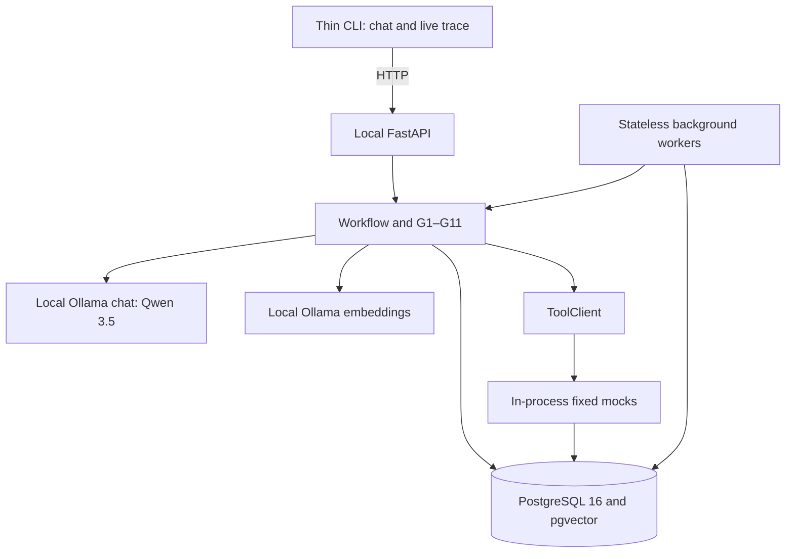

# Errand Agent — design decisions

The full reasoning behind [DESIGN.md](DESIGN.md), the one-page design note. Code and docs cite these sections as "DECISIONS §N". The assignment PDF is the source of truth and every requirement in it is binding. Where a decision changed during the build, its section says what replaced it; §16 summarises those changes.

## 1. Keys and attempts — retained

Adopt one stable opaque idempotency key per immutable approved operation, with separate dispatch attempt IDs/ordinals. New keys per transport attempt risk duplicates; one conversation-wide key conflates distinct actions. Persist approval consumption, operation/key and dispatch reservation before invoking tools; uniquely associate proposal revision with operation. Repeated confirmation returns its existing result. Material change requires a fresh proposal/approval/key only after resolving the old ambiguous outcome. Known no-effect transient errors are nonterminal attempts; terminal outcomes replay, committed effects never resample. These semantics and the unchanged mock signatures must both survive restarts.

## 2. Focused calls and recounted limits — v1 count superseded

Native tool calls split language extraction, action choice and optional non-consequential phrasing. One call yields at most one accepted tool proposal; reject extra/parallel proposals rather than executing a batch. Code decides facts, ranks, renders consequential details and forces recovery. There are no hidden inference calls for memory, summarization, comparison rendering or status narration.

| Stage of full booking with one clarification | Focused calls | Tools/outputs |
| --- | ---: | --- |
| Initial incomplete request: extract fields; choose ask; phrase neutral question | 3 | Internal `update_request`, `ask_user`; phrasing has no tools. Code renders field labels and any facts. Wait ends run. |
| Clarification reply: extract update | 1 | `update_request`; deterministic date resolution and field validation |
| Choose search | 1 | `search_providers`; code filters/ranks and renders comparison |
| Choose provider details | 1 | `get_provider` for the code-ranked/user-selected real provider |
| Choose option | 1 | Internal `select_option`, constrained to the user selection or code-ranked first eligible option |
| Choose hold | 1 | `hold_slot`; code renders actual quote and approval card, no phrasing inference. Wait ends run. |
| Valid user confirmation: choose approved action | 1 | `book`; code forces `get_booking_status`, then renders verified result |
| **Total** | **9 logical calls** | **5 fixed backend tools + 4 internal actions = 9 invocations** |

A fully specified request skips the initial three-call clarification exchange and needs **6** logical calls. Resolving “same as last time” adds one focused `list_bookings` selection call and one backend invocation: **10** logical calls/10 total tool invocations for the clarified flow. `list_bookings` supplies history; never replay chat. Additional clarification replies, candidate inspections or phrasing calls cost actual counters, not zero.

The three ordinary runs use **3 / 5 / 1** logical calls (history makes its run one call larger). `get_booking_status` is code-forced, consumes a tool counter but zero inference. Timeout without success followed by a same-key retry adds `book` + status to tool counters; retry is continuation of the already validated model-driven operation, not a new model decision. Cancellation and reschedule still require their own model-proposed approved action.

Retain **10 logical calls, 40 physical inference requests, 20 tool invocations, 300 seconds active time per run**. Internal workflow actions also consume tool counters, as do code-forced checks, retries and failed dispatches. Waiting for user input ends a run. Valid clarification flow fits before retries; worst loaded ordinary run has six logical calls including history, safely below ten. Every loop reserves counters durably before dispatch, and new runs cannot reset an operation's lifetime allowance.

Each extraction/action logical call allows original generation + three retries = four physical requests. Neutral phrasing allows original + one grounding regeneration = two physical requests; no hidden G6 × G10 retry multiplication. Thus the nine-call clarified flow has at most **8 × 4 + 2 = 34 physical requests** across runs; history has **9 × 4 + 2 = 38**. The fully specified six-action flow allows 24. Forty per run remains a safe upper bound for any ten logical calls; earlier deadlines can stop before those maxima. Temperature 0 and seed 42 are fixed, but do not promise bitwise model determinism; scripted calls supply eval determinism.

Retain per-operation lifetime caps across restarts: **3 consequential dispatches, 6 reconciliation invocations, 40 physical model calls, 300 charged active seconds**. Run and operation limits both apply. Per-model-call deadline is at most 60 seconds and remaining budget, cold-load included. Persist reservations/deadlines; on crash conservatively charge outstanding work. Lock waits, tool calls and grounding retries count toward active deadlines; queued retry/user waiting does not. Bound embedding requests to 10 seconds each and four per run, also within active time; prefer cached query vectors. Finite limits end in explicit failure or pending-verification templates, never false success. Read-only manual inspection remains possible after execution budget exhaustion. Planned tests assert exact sequences/counters, each independent cap, retry maxima and restart preservation.

## 3. Context budget — retained, native schema accounting revised

Input cap **4,096**, output cap **768**, configured local context **8,192**. Allocation remains an educated estimate pending exact Qwen 3.5 tokenizer/template validation; no measured count is claimed.

| Component | Input allocation |
| --- | ---: |
| System policy, trust, approval/recovery | 600 |
| Current state-scoped native tool schemas and internal actions | 850 |
| Current request/proposal/operation/approval facts | 550 |
| Current user message | 350 |
| Structured candidates/tool data | 700 |
| Eligible relevant memories | 350 |
| Delimited untrusted review excerpts | 150 |
| Retry diagnostics/invalid argument excerpt | 300 |
| Qwen template, native-tool framing, delimiters/accounting reserve | 246 |
| **Total** | **4,096** |

The earlier “all eight schemas every call” assumption is superseded: only state-valid tools are serialized. Enum expansion counts too. Use separate narrow calls instead of fitting all states at once. Count the final prompt, tools and retry framing with the pinned Qwen tokenizer/template before dispatch and compare against runtime usage in integration tests. Never rely on chars/token or silent context truncation. If dependency access to the tokenizer needs setup, acquire it locally then; no PyTorch/sentence-transformers runtime dependency is introduced.

Drop order remains: (1) reviews, (2) lowest-ranked optional memories, (3) extra unselected candidate descriptions/nonessential old tool data, (4) shrink retry excerpt. Keep policy/schema, current user intent, approved material facts, unresolved status and candidate facts required for this decision. Do not silently omit enum values while pretending they remain selectable: page the options explicitly if needed. If essentials still overflow, no inference; use a clear shorter-input/menu template. Excluded/forgotten/unconfirmed facts and raw prior conversation are never candidates for inclusion. Tests capture complete prompts and enforce exclusion and token counts on originals and retries.

## 4. Model runtime and invalid output — runtime superseded twice (now §17), retry rule retained

Use local Ollama `/api/chat` with native `tools` and `message.tool_calls`, **not JSON-schema-in-content prompting**. The [Ollama tool guide](https://docs.ollama.com/capabilities/tool-calling) documents this interface. Extraction uses internal `update_request` tool arguments; action choice exposes only permitted native functions. This is an orchestration layer, not a change to the eight backend contracts.

Select tools-capable **Qwen 3.5**, initially evaluate `qwen3.5:4b`. The [Ollama tag page](https://ollama.com/library/qwen3.5:4b) currently advertises tools and shows a 4B quantized artifact; installed tag, complete disk size, quantization and full digest must be confirmed during setup, not inferred from a moving alias. No download or smoke test has been run here. Pin full digest, Ollama version, tokenizer/template and temperature 0/seed 42; disable thinking if supported by that pinned tag. Reject cloud tags; loopback-only runtime and disconnected verification. ModelMux is separate historical infrastructure.

Before finalizing size, run the three PDF requests with injected date/time and seeded provider data: plumber/this week/mornings/₹1,500; move AC servicing/Saturday; same electrician/not before 10 a.m. Record first-pass valid native-call rate, rate after retries, schema/state validity, missing-field handling, latency per call and full flow (cold/warm), and peak RAM. A valid-call denominator is every expected tool-choice turn, not just successful responses. Initial acceptance target: all three end-to-end flows pass guardrails, no invalid side effect, every run fits 300 seconds; report observed first-pass rate rather than hiding failures. If 4B fails, compare another tools-capable Qwen 3.5 size within available memory before locking the model choice. Smoke success is not a substitute for offline invariant tests.

Malformed tool call or invalid arguments: conservative local repair (whitespace or one enclosing code fence inside a stringified argument object), then strict syntax/schema/state/semantic validation; no invented values, permission, missing keys or truncated arguments. Allow up to **three additional model requests** with bounded diagnostics, validating each; four total per logical action. Trace every generation, repair attempt, failure and consumed budget. Valid syntax does not establish authority. Unsupported tool names, fabricated enums, argument mismatch, extra calls or state violations cannot dispatch. Invalid-output exhaustion produces a visible code template and offers degraded mode (§12 G9); if a run cap interrupts sooner, report the actual cap/count. No hidden reasoning is logged.

Neutral phrasing uses a separate no-tools call. G6 has exactly one regeneration; if either output is malformed/ungrounded, use a template at the second failure rather than starting another three-retry cycle. A late worker's model result cannot update state after its revision/claim has changed.

## 5. Material changes — retained, code-rendered

Validate hold/current facts before approval consumption and dispatch; backend checks hold expiry atomically too. Expiry: “The hold for {slot} expired, so I haven't booked it. I'll check availability again. Any new hold needs your approval.” Say “haven't booked” only when no effect is known; an unknown attempt gets pending-verification wording. New price: “The quote changed from {old_price} to {new_price}. Your earlier approval no longer applies.” Render a new exact card with new token and ask fresh approval only if within current constraints; otherwise ask about budget/alternatives. Search estimate versus held quote is shown before first approval. Slot/provider changes and reschedule conflict follow the same invalidation rule. Never silently loosen constraints or transfer old approval.

## 6. Confirmation forms — retained, service/CLI binding added

Accept normalized standalone `yes` or `confirm <token>` only from real user input, tied to latest actually displayed unchanged revision, request version, authenticated local session, correct ownership, valid hold and pending proposal. One actionable proposal per session. FastAPI issues opaque display revision/receipt; thin CLI acknowledges rendering and attaches the revision current when its input prompt opened. Server validates receipt/revision rather than trusting a caller's invented “latest” value. Pending newer revisions or material changes invalidate the old yes; never bind it to an unseen replacement. Tokens obey identical freshness checks. Code handles these messages before inference. Duplicate unchanged confirmation returns existing operation outcome without re-execution. Memory confirmation is separate.

Tests exercise both forms for all three consequential actions, stale provider/price/slot/hold, expiry, correction while typing, repeated/restarted input, cross-session reuse, absent card, event race and forged model/review approval.

## 7. Memory authorship — retained

Code-generated inferred candidates are narrower but auditable and avoid model-written memory poisoning. Model inference handles nuance but can persist malicious reviews as plausible user preference, adds cost and weakens reproducibility; a hybrid still needs provenance checks and explicit confirmation. Choose code: e.g. three distinct user-selected, completed morning errands yield an **unconfirmed** candidate. Exclude automatic suggestions, duplicate attempts, raw reviews and model assertions. Never infer permissions/approval policy.

Keep provenance/source event IDs, scope, explicit/inferred origin, reason/confidence, confirmation, revision and deletion state. Only a separate user memory-confirmation action activates a candidate. Unconfirmed candidates appear only in a deterministic management view, never context, summaries, ranking or embedding queries. Inspect/correct/forget remain supported across sessions; origin remains inferred after confirmation. The model may extract explicit user statements, with code validating source and ambiguity. Current user instructions override stored preferences; transient corrections do not automatically become persistent facts.

## 8. One agent and deterministic workers — retained, architecture extended

One language agent; deterministic workers handle dispatch, retries, reconciliation, cancellation watching and notification. A second LLM offers specialization but adds coordination over budgets, approvals and state with no required capability benefit. Workers scale independently of agent count, are stateless and use only Postgres as durable state. A deterministic watcher consumes simulated cancellations without user prompting, considers active upcoming bookings, invalidates affected proposals and queues replacement work under current confirmed constraints. It notifies through outbox/inbox, searches for valid replacements, explains no-match constraints and waits for fresh approval; never auto-rebooks.

ToolClient preserves exact contracts now and permits HTTP transport later without changing the workflow; moving mocks is not current scope. FastAPI binds locally, associates sessions with the local user, exposes durable notifications/traces and carries display revisions. CLI does input/rendering only. Exclude Redis, Kafka, Kubernetes, microservices, separate vector DB and cloud LLM. Relative dates resolve against injected clock and user timezone (default Asia/Kolkata), never process-local wall-clock guesses. “This week” means current local date through Sunday; “Saturday” is the next nonpast eligible Saturday; mornings default [09:00,12:00), “not before 10” means inclusive 10:00. Show resolved windows via templates; ambiguous/past/unsupported expressions trigger clarification. Model extracts source expressions with spans; code validates spans against user text and computes dates. Explicit ISO dates are validated by the same parser. Budget/number parsing also validates the original user source.

Code applies hard constraints first (budget, resolved window, confirmed preferences), then stable ranking: price ascending, rating descending, provider ID and slot ascending as ties. Explicit confirmed/user-selected provider restricts candidates; model cannot override ordering or change eligibility. Unknown price/availability requires tool data rather than a guessed score. The original eight-tool boundary stays fixed; internal actions merely update workflow. Comparison/approval/outcome templates reference current DB facts, never model prose.

## 9. Postgres locking, claims and job queue — v1 SQLite/singleton superseded

Adopt **PostgreSQL 16 + pgvector in local Docker Compose**, including tests. A single logical database contains sessions, requests, proposals/display receipts, approvals, operations, attempts, mock providers/holds/bookings/replay records, memories, jobs, outbox and traces. Pin compatible Postgres-16 pgvector image digest and extension version during setup; test the same migrations/image as runtime, with isolated per-test data. No SQLite test substitute.

Use `pg_advisory_xact_lock(session_id)` with stable unique bigint session IDs, short transactions and bounded lock timeout (at most 2 seconds/remaining deadline). The [Postgres locking documentation](https://www.postgresql.org/docs/16/explicit-locking.html) describes transaction-scoped advisory locks. They serialize transitions/claims, **not time spent outside transactions**; a durable per-session active claim prevents two workers advancing the same conversation while either is doing model/tool work. Claims store job/operation, revision, generation, lease/deadline and budget reservations. Reacquire advisory lock to commit a result only if generation/revision still match. An expired model result is discarded. Incoming corrections/cancellation events serialize and invalidate stale proposals/results without waiting on inference.

Claim due jobs via `SELECT … FOR UPDATE SKIP LOCKED`; persist claim/generation and reserve counters in the claim transaction, then commit before model/tool calls. The next transaction records outcome and schedules continuation. Adopt one lock order: session advisory lock before locking that session's job/operation rows; candidate queue polling may read candidates first but must recheck eligibility under the locks. Avoid a queue-row/session-lock cycle. Finite lock/query timeouts and clear retry/pending messages apply.

A lease alone does not stop a delayed worker from executing a side effect. Before each in-process mock side effect, atomically verify session claim generation, operation/attempt reservation and immutable approved snapshot in the **backend mutation transaction**, using the same session advisory lock. Replayed committed keys return their effect; revoked/stale claims cannot commit a new effect. Pass claim metadata through internal ToolClient execution context, not new tool arguments. Recovery fences an expired claim before reconciling; late completions cannot overwrite newer state. Even after fencing, an unknown booking is reconciled by key before a retry, never assumed failed. Moving ToolClient behind HTTP later would require equivalent server-side idempotency/fencing; it is not assumed safe by transport abstraction alone.

Approval consumption, unique proposal→operation, key uniqueness, revision CAS, and unique event ingestion protect invariants. Backend effects plus their replay record commit together. No transaction spans inference/tool transport. Jobs and outbox changes commit with the state change that creates them; at-least-once delivery with stable event/user IDs does not claim exactly-once terminal display. Compare: Postgres adds Docker/migrations and more concurrency tests than SQLite, but gives one production/test behavior and shared workers; distributed brokers or a singleton lock would respectively add needless infrastructure or block the intended concurrency. Crash/interleaving tests are required before claiming these guarantees.

## 10. Ollama embeddings and pgvector — MiniLM/PyTorch superseded; reconfirmed for embeddings only in §18

Choose **`nomic-embed-text:v1.5`, native 768 dimensions**, via local Ollama `/api/embed`. The [Ollama model listing](https://ollama.com/library/nomic-embed-text) supplies the tag; the [Nomic model card](https://huggingface.co/nomic-ai/nomic-embed-text-v1.5) describes 768-dimensional representations and retrieval prefixes. Pin full installed digest/runtime and verify response dimension during setup; no digest has yet been installed/verified. Do not use sentence-transformers or PyTorch. Prefix query with `search_query: ` and canonical fact with `search_document: ` consistently, pin normalization and content hashes. [Ollama embed](https://docs.ollama.com/api/embed) supports rejecting excess input with `truncate=false`; use that rather than silent truncation.

Store typed fact and `vector(768)` in the **same memories row**, alongside provenance/status and embedding version/hash. Correction prepares replacement vector outside a transaction, then atomically CAS-updates fact+vector+revision under the session lock; stale vectors never become current. If encoding fails, do not leave an old active preference: mark the corrected fact pending/unavailable for retrieval until the new vector can commit, and show this to the user. Forget deletes or clears fact+vector together and invalidates derived context in the same transaction. Never retain forgotten text in active summaries or re-embed it from history. Traces are audit-only, excluded from retrieval.

SQL hard-filters **user, scope, current revision, not forgotten, confirmed, applicable field** before any similarity evaluation. Use a materialized eligible relation for the exact scan so excluded facts never rank. Query text derives only from current structured request, never raw chat/reviews. Use exact pgvector cosine similarity over the small eligible set; no approximate index is needed for 50+ facts. [pgvector](https://github.com/pgvector/pgvector) supports exact cosine retrieval. Initial top-k=6, minimum cosine=0.30 (hypothesis to calibrate on labeled fixtures, then freeze), 350-token memory allocation, score rounded to six decimals and memory ID as tie-break. Hard applicability filters and explicit relevance fixtures are mandatory; similarity is not trust. Current required constraints live in workflow state, not optional retrieval.

Offline scenarios check in query/memory fixture vectors, normalized inputs and model/dimension/hash manifest. They exercise real Postgres SQL filtering, cosine ranking, tie-break and context budgeting, with scripted chat; no Ollama needed for ordinary evals. Separate disconnected Ollama integration check encodes known relevant/irrelevant pairs and checks ordering with tolerance, dimension and prefix consistency. Pin versions and use margin-separated pairs; no cross-hardware bitwise float promise. Missing artifacts fail clearly, never auto-download in offline tests. The long seeded prior conversation exists **to prove none of it reaches the model**; booking history comes only from `list_bookings`. At least 50 seeded memories include forgotten, obsolete, unconfirmed and irrelevant records.

## 11. Durable cancel-503 state — retained, queue replaces local scheduling

Persist operation/key, booking, approved snapshot, attempts/reservations, retry count, error, `next_retry_at`, generation and lifetime allowances. State: `approved → executing(1) → retry_wait(503, +1s) → executing(2, same key) → succeeded`. Required first 503 is a known no-effect attempt, not permanent terminal replay; backend persists this phase. Additional scenario-only transient faults allow third dispatch after 2s; default PDF scenario remains first fails, retry succeeds. All attempts consume the original lifetime budget.

A due Postgres job claims the retry; no blocking sleep/held transaction. On crash after backend 503 but before client receipt, backend's persistent phase ensures the next same-key call advances correctly. On uncertain cancellation completion, inspect via `list_bookings(user_id)` (the hold/key status tool is for booking) and replay the same cancellation key within bounds if needed. Observed provider-cancelled state is reported as observed, not falsely attributed to our call. Exhausted ambiguous operations remain pending verification. Fake clock tests cover pre/post-503, before due, post-success/pre-client-commit, exhausted limits, late/fenced workers, backend restart and provider-cancellation race.

## 12. Mandatory hallucination guardrails (G1–G11)

Core rule: **LLM handles language; code owns facts.** Extraction is an untrusted proposal, not a fact update until code validates source, types, constraints and revision. All consequential details and outcomes come from code. Omission from a tool list is backed by server dispatch validation; hallucinating an unoffered name never makes it callable.

| ID | Guardrail and enforceable rule | Planned tests |
| --- | --- | --- |
| G1 | Rebuild native tool allowlist by state; expose internal `update_request`/`ask_user` in collecting, search/details/`select_option` in comparing; hold only after validated selection. Consequential tools appear only for a live approved operation in executing. Verifying permits status/reconciliation, not new action choice. Deny anything outside offered set at dispatch too. | E28 out-of-state book; E33 every state's allow/deny matrix |
| G2 | Rebuild provider/slot/booking/hold enums every turn from actual session/tool data; also check tuple relationships, ownership, revisions and key bound to operation. Empty allowed set means omit that tool. No invented IDs, foreign hold or valid-but-wrong provider/slot pair. | E25 invented provider; E34 enum relationships/stale values |
| G3 | Model extracts relative date/time expressions with source spans; deterministic parser uses injected clock/timezone and clarifies ambiguity. Model never computes dates; code validates explicit dates too. | E01–E04 PDF examples/clarification; E35 boundary/date hallucination |
| G4 | Code filters and ranks (§8), model can explain only code ordering or identify explicit user's existing option. It cannot change ranking, eligibility, budget or preferences. | E36 deterministic ranking/over-budget override |
| G5 | Code templates render comparisons, approval cards, material prices/slots, statuses, consequential confirmations and errors. Model writes only optional neutral language. | E26 misquoted price; E27 premature success |
| G6 | Before any model text display, scan numbers/currency/dates/provider names/IDs/status words, including negation and context, against a fact allowlist for that reply purpose. Correct-but-premature status still fails. One regeneration, then safe template; log violation. Free-text grounding is fallible, so no consequential claim may rely on this scanner: G5 templates are the final boundary. | E26/E27; E37 scanner variants and fallback |
| G7 | Model proposes book/cancel/reschedule; validate exact agreement with approved snapshot then ignore supplied arguments for dispatch, sourcing action/provider/slot/price/hold-or-booking/key from stored snapshot. Any mismatch rejects whole proposal; never silently “fix” it and execute. After timeout, code unconditionally schedules `get_booking_status` before retry/success, even if model says skip it. | E29 differing approved arguments; E10/E11 forced reconciliation |
| G8 | Narrow extraction → action selection → optional neutral phrasing calls; temperature 0, seed 42; native calls restricted each time. Code handles facts and outcome narration; no parallel unchecked actions or hidden inference. | E38 call-count/schema/settings assertions |
| G9 | On repeated model failure after repair+three retries, display clear failure and deterministic numbered menu: supply missing fields, choose an existing ranked option, inspect pending status, retry language step, or stop. No hallucinated action executes. Menus preserve exact approval/revision rules. Safe data collection can continue; new consequential dispatch still needs a valid model proposal and approval, or stays paused. Already validated operations may reconcile/retry deterministically within budgets. Never pretend a broken model completed the real-LLM workflow. | E30 menu fallback/valid selections; E39 pending-recovery safety |
| G10 | Native call envelopes/arguments get conservative local repair then up to three inference retries and visible failure; validate state/schema/semantics/authorization each time, trace every attempt and enforce counters/deadlines. No model-output repair can create missing facts/authority. | E17 malformed/final retry/exhaustion; E25/E28/E29 |
| G11 | Reviews/other free text only in clearly delimited untrusted data blocks, never instructions; escape delimiter-like contents. They cannot update request, memories, permissions or approvals. Extraction prompts receive user-source fields, not provider text. | E16 user/review injection; E40 delimiter escape and memory poisoning |

Date/number/provider/status scanners must recognize supported display formats and test adversarial variants. Unrecognized material language is rejected or templated; a grounding match does not authorize action. Internal action schemas are not extra provider tool contracts. They cannot manufacture IDs, execute side effects, or weaken the eight contracts.

## 13. Fixed mock contracts and evidence

All contracts below are the PDF's unchanged agent-facing environment. ToolClient internal context carries claims/scenario data without adding arguments to these signatures. Scenario overrides/fake clock are test controls, not extra tools. Default random behavior uses a seeded durable sequence; configurable branches isolate edge cases. Replays do not reroll a committed result. Prices/IDs/dates in user output are rendered from these results and validated state.

| Tool signature | Fixed behavior | Planned tests |
| --- | --- | --- |
| `search_providers(service, area, date_range)` | 3–8 providers, IDs, prices, ratings, available slots, relevant attributes | E41 contract cardinality/fields/seed replay |
| `get_provider(provider_id)` | Details and free-text reviews; at least one review with prompt injection | E16, E41 |
| `hold_slot(provider_id, slot)` | Ten-minute hold with ID/expiry; quote may differ from search price | E08/E09, E41 |
| `book(hold_id, idempotency_key)` | 70% success, 15% slot_taken, 15% timeout; half of timeouts actually book; hold_expired past expiry | E09–E12, E41 verifies configured branch mapping and default distribution mapping |
| `get_booking_status(hold_id or idempotency_key)` | Authoritative source for ambiguous booking resolution | E10/E11/E13 |
| `cancel(booking_id, idempotency_key)` | First call transient 503, retry succeeds | E14/E31 |
| `reschedule(booking_id, slot, idempotency_key)` | Reschedule; configured conflicting slots yield slot_conflict | E02/E15 |
| `list_bookings(user_id)` | Past/upcoming bookings including ID, provider, service, slot, status | E03/E41 |

Trace records live in Postgres and export JSONL. Correlate run/session/message/proposal/revision/operation/key/attempt/job/generation; log state transitions, offered tool schemas, exact input context/memory IDs, native proposals, validation/grounding/repair results, dispatched authoritative arguments, sanitized results, latency, token usage and exit reason. Record model digest/settings and embedding version. Suppress secrets/hidden reasoning; provider text remains labeled data. Estimated cost is unavailable unless a defensible cost basis exists, not fabricated API token billing for a local model. Audit records never feed memory retrieval. Export must preserve event ordering and post-crash recovery evidence.

Required timeout-after-success evidence remains pending: persist operation K → backend commits booking/replay → client sees timeout → forced authoritative `get_booking_status(K)` → persist verified result → template success. Produce raw JSONL and a short annotated **actual** excerpt in the one-page note after implementation; no synthetic trace is evidence. Generate evaluation table columns **scenario · expected · actual · pass/fail · notes** directly from scenario assertions. Track at least three genuinely encountered bugs (what/why/fix/regression), assistant transcript, repository/README and a 3–5 minute full-booking recording with chat/trace side by side. Live failure handling is a desirable demo plus, not a substitute for core requirements.

## 14. Evaluation plan and complete PDF requirements trace

Every E-ID below is a planned automated scenario family; parametrizations can expand it. Implement **at least 20 distinct simulated-user scenarios**, not just twenty assertions. Use the same PostgreSQL-16/pgvector schema and in-process ToolClient as runtime, scripted/recorded native chat outputs, fake clock, seeded providers and fixture vectors. No Ollama/cloud/network requirement in ordinary evals beyond local Postgres connectivity. Separate local chat/embed smoke integration tests are reported separately. E42–E45 are artifact/integration acceptance checks, not counted as substitutes for twenty simulated-user scenarios. Assert persisted outcomes, proposal validity, invocation history, bounded counters and **no side effect from rejected output**, rather than reply wording alone.

### Scenario inventory

| ID | Scenario family and required invariant |
| --- | --- |
| E01 | Plumber request, only missing area asked; morning/date/budget resolved by code, no re-asking supplied fields |
| E02 | AC servicing move to Saturday; correct original booking and exact old/new-slot approval |
| E03 | Same electrician via `list_bookings`, not history replay; not before 10 honored, ambiguity clarified |
| E04 | Single-detail correction preserves unrelated state, stale proposal invalidated |
| E05 | Both confirmation forms for booking/cancel/reschedule; no confirmation/forged approval cannot execute |
| E06 | Repeated confirmation and replay after restart return same operation/effect |
| E07 | Provider/slot changes after approval invalidate both confirmation forms |
| E08 | Held quote differs from search/changes after approval; show actual quote and require fresh approval; over-budget remains blocked |
| E09 | Expired hold before confirmation/during backend dispatch; no silent transfer to new hold |
| E10 | Timeout after actual booking: status forced, exactly one booking, no premature success |
| E11 | Timeout with no booking: source-of-truth lookup precedes same-key retry; original budget/hold respected |
| E12 | Slot taken/terminal error replay; old approval cannot authorize replacement |
| E13 | Restart before dispatch/after backend commit; reconciliation before retry, stable key/effect |
| E14 | Default cancel 503 then success, same key, durable attempt state |
| E15 | Reschedule conflict preserves original booking and needs fresh approval for alternative |
| E16 | Adversarial user instructions and injected provider reviews cannot change intent/permissions/approval |
| E17 | Malformed native calls/arguments: repair, third retry success, exhausted path and exact traced counts |
| E18 | Unexpected tools/status failures preserve truthful known/unknown result and finite exit |
| E19 | Explicit/inferred memory inspection, separate confirmation, cross-session preference reuse |
| E20 | Correct/forget atomically updates/removes fact/vector; no stale summary/cache resurrection |
| E21 | 50+ mixed memories and long prior conversation: only relevant/current/confirmed facts included; zero raw prior chat |
| E22 | Token cap, drop order, enum growth and oversized essentials; every input/repair context bounded |
| E23 | Model/tool/embedding/time and lifetime caps, repeated resume cannot reset allowance; user-visible outcome |
| E24 | Proactive cancellation without user input; constraints respected, fresh approval before replacement, no-match explanation |
| E25 | Script invents provider ID: enum rejection traced; no backend side effect from bad output |
| E26 | Script misquotes price: text blocked before display, one regeneration/template; no side effect from bad output |
| E27 | Script claims booked before verification: text blocked, no success display or consequential dispatch from it; forced reconciliation retained |
| E28 | Script calls `book` while comparing: unoffered tool rejected and traced; zero side effect |
| E29 | Script proposes `book` arguments differing from approved snapshot: reject rather than normalize/execute; zero side effect |
| E30 | Repeated model failure: visible numbered degraded menu; valid choices collect state without bypassing guards |
| E31 | Cancel retry across pre/post-503 crash, future due time, retry-success crash and exhausted attempts |
| E32 | Multi-worker same-session races, unrelated sessions progress, stale leases/results fenced, no duplicate effects |
| E33 | Every state's native tool allowlist and dispatch denylist agree; extra/parallel calls rejected |
| E34 | Real-but-wrong provider/slot/hold/booking relationship, cross-user values and stale enums blocked |
| E35 | Injected clock/timezone midnight/week boundaries; model-invented dates/source spans rejected |
| E36 | Stable code ranking, ties, invalid budgets/preferences; model cannot reorder or loosen constraints |
| E37 | Grounding variants: numbers/currency/dates/names/IDs/negated or premature statuses; fallback after exactly one regeneration |
| E38 | Focused-call sequences, native tools, temperature/seed and no hidden inference; 9/10 count and physical caps |
| E39 | Degraded/limit mode with unknown operation does not claim failure or create another booking |
| E40 | Delimiter breakout and inferred-memory poisoning through reviews cannot reach trusted state |
| E41 | All eight exact contracts; default probability branch mapping and seeded restart sequence; status/hold/history fields |
| E42 | Disconnected local Qwen 3.5 three-example smoke: call validity/latency/memory; exact installed artifacts pinned |
| E43 | Postgres migrations/pgvector compatibility, no SQLite; real local embedding pair-ranking/dimensions; fixture ranking/filter tests |
| E44 | Outbox event/user dedupe, crash before/after send, offline inbox, stable redelivery IDs, cancellation duplicate/no-match |
| E45 | Generated eval table matches assertions; raw real trace + note excerpt, actual bug regressions, README/repo/transcript/demo and one-page export checklist |

In E25–E29 assertions are made at the rejection boundary; a later explicitly valid scripted response is a separate step, never permission to execute the rejected proposal. All five requested hallucination attacks explicitly assert both blocked output and zero effect caused by it. E27 preloads an unverified operation but blocks any new side effect; if a backend effect already exists from the simulated timeout, assert no **additional** effect and no unverified success. A separate pre-dispatch variant starts with no effect and asserts zero total effects.

### PDF requirement → design → planned verification

This table covers PDF §§1–5, including individual failure modes and deliverables. No row is waived. Section references below target this document; the compact note summarizes them.

| PDF requirement | Current design section | Planned test(s) / acceptance evidence |
| --- | --- | --- |
| §1 Chat clarifies, compares, obtains approval, recovers | §§2,5,6,8,12 | E01–E18 |
| §1 Fully local; no real providers/payments/external services | §§4,8–10,13 | E41–E43 disconnected runtime; local-only dependency/config audit |
| §1 Three example requests | §§4,8 | E01–E03 + E42 real-model smoke |
| §2 Fixed names/inputs/outputs/failures, seeded/configurable mocks | §§1,13 | E41 all eight signatures and deterministic branch fixtures |
| §2 search: 3–8 providers, prices/ratings/slots/attributes | §13 | E41 search contract and code ranking E36 |
| §2 details/reviews including malicious review | §§12 G11,13 | E16/E40/E41 |
| §2 hold ID/expiry, ten minutes, quote change | §§5,13 | E08/E09/E41 |
| §2 book 70/15/15, half timeouts booked, expired hold | §§1,5,13 | E09–E12/E41 seeded bucket mapping, both timeout branches |
| §2 authoritative status by hold or key | §§1,12 G7,13 | E10/E11/E13/E41 both lookup forms |
| §2 cancel first 503 then successful retry | §§11,13 | E14/E31/E41 |
| §2 reschedule and configured slot conflict | §§5,13 | E02/E15/E41 |
| §2 list past/upcoming booking fields | §§8,13 | E03/E41 |
| §3 collect only missing service/area/date-time/budget/preferences | §§2,8,12 G3 | E01/E03/E04/E35 |
| §3 never re-ask supplied facts, retain unrelated corrections | §§6,8,12 | E01/E04 |
| §3 explicit workflow/state model | §§8,12 | E33 state transition/allowlist coverage |
| §3 code-enforced exact approval for book/cancel/reschedule | §§5,6,12 G7 | E05/E29, both forms on all actions |
| §3 material provider/slot/price change revokes approval | §§5,6 | E07–E09/E32 |
| §3 hard model/tool/wall-time bounds | §§2–4,9 | E17/E22/E23/E38 |
| §3 every exit clear, exhausted retries/unexpected errors safe | §§2,4,11,12 G9 | E17/E18/E23/E30/E39 |
| §3 no duplicates on repeated confirmation/network retry/restart | §§1,6,9 | E06/E10/E11/E13/E32 |
| §3 timeout source-of-truth check before retry/success | §§1,12 G7,13 | E10/E11/E13/E27 |
| §3 never claim success before verification | §§12 G5–G7,13 | E10/E18/E27/E37 |
| §3 free-text tool data never instructions or permission | §§7,12 G11 | E16/E40 |
| §3 injection cannot alter intent/approval/permissions | §§6,7,12 | E16/E28/E29/E40 |
| §3 stable preferences across sessions | §§7,10 | E19 |
| §3 inspect/correct/forget stored memory | §§7,10 | E19/E20/E43 transaction checks |
| §3 distinguish explicit/inferred memory | §§7,10 | E19/E21/E40 |
| §3 trace every run: transitions/model/tools/args/results/latency/usage/cost where available | §§4,12,13 | E17/E25–E29/E45 trace-field assertions; unavailable cost explicit |
| §3 at least 20 offline simulated-user scenarios | §14 | E01–E41/E44 scenario inventory and generated count; artifact checks do not replace them |
| §3 assert outcomes/invariants, not just wording | §14 | Persisted outcomes/approval/tool invariants in every scenario |
| §3 eval adversarial input/review injection | §§12,14 | E16/E40 |
| §3 eval changed price/slot after approval | §§5,6,14 | E07/E08 |
| §3 eval ambiguous timeout, conflict, repeated confirmation | §§1,5,6,13,14 | E06/E10/E11/E15 |
| §3 eval memory correction/forget, restart mid-booking | §§7,9,10,14 | E13/E20 |
| §3 eval proactive cancellation/context/limits/tool failures | §§2,8,11,14 | E18/E21–E24/E44 |
| §3 detect simulated provider cancellation without prompt | §§8,9 | E24/E44 |
| §3 decide whether/how to notify, including offline delivery | §§8,9 | E24/E44 affected/upcoming-only policy, outbox/inbox |
| §3 find replacement within known preferences | §§8,10,12 G4 | E24 no match, unchanged constraints |
| §3 fresh approval before replacement booking | §§5,6,8 | E24/E05 |
| §3 seed ≥50 memories and long conversation | §§3,10 | E21 seeded fixture counts |
| §3 fixed context cap, only relevant/current preferences | §§3,10 | E21/E22 exact rendered context and SQL eligibility |
| §3 no forgotten/unconfirmed inferred facts in model context | §§7,10 | E20/E21/E40; zero history leakage |
| §3 log context every turn and prove with tests | §§3,13 | E21/E22/E45 captured payload vs trace |
| §4 fixed tools; explain orchestration trade-offs | §§1,8,9,13; DESIGN.md | E41 plus design review against PDF |
| §4 real LLM understands requests/drives tool calls | §§2,4,12 G7–G9 | E42 real native tool smoke; degraded flow cannot claim full model completion |
| §4 automated evals offline/scripted or recorded | §§4,10,14 | E01–E41/E44 no external calls; fixture vectors and Postgres |
| §4 single agent allowed; justify additional agents if any | §8 | One language agent, deterministic workers; architecture review |
| §5 Git repo with implementation/mocks/tests/README | §§13,15 | E45 checkout/setup/run instructions from clean local environment |
| §5 max one-page design: state/approval/idempotency/recovery/memory/observability | DESIGN.md; §§1,5–10,13 | E45 exported page-count/manual legibility check, including final trace excerpt |
| §5 generated eval table with all five columns | §§13,14 | E45 assertions generate expected/actual/pass-fail/notes |
| §5 three real bugs: what/why/fix/regression | §§13,15 | E45 actual encountered bug log, linked running regression tests |
| §5 raw end-to-end timeout-after-success trace plus annotated note excerpt | §13; DESIGN.md trace excerpt | E10/E45 real JSONL export and actual annotated excerpt |
| §5 3–5 minute full-booking demo, chat/trace side by side | §§8,13,15 | E45 recording duration/content review; live failure desirable |
| §5 coding-assistant transcript | §§13,15 | E45 retained/exported conversation artifact |

## 15. Risk-ordered build plan (all 8 stages done)

Each numbered stage is split into reviewable tasks. Run its acceptance checks before proceeding. Tracing hooks and minimal journal events start with persistence/recovery even though the full exporter/eval report is stage 7. Use direct workflow/test harness calls until stage 8; no UI dependency blocks safety validation.

1. **Postgres schema + Compose + test harness.** (a) Pin PostgreSQL-16/pgvector image and create local-only Compose lifecycle/health checks, test isolation and migrations. (b) Define sessions/revisions/proposals/receipts/approvals, operations/attempts/budgets, backend holds/bookings/replays, memory rows/vectors, jobs/outbox/traces and required constraints. (c) Prove transaction rollback, same-schema test setup, per-session advisory locking, claim-generation CAS and multi-session concurrency. Gate: E32/E43 skeleton and schema/constraint tests pass against real Postgres. Trade-off risk: concurrency/atomicity before agent behavior.
2. **Exact mock tools.** (a) Implement ToolClient and all eight signatures/outputs. (b) Seed deterministic providers/history/review injection, ten-minute holds/quote drift and configurable failure branches. (c) Persist RNG progression, replay effects and first-cancel-503 phase; fake clock controls expiry. Gate: E41 plus backend parts of E08–E15; no retries/restarts reroll committed results or change contracts.
3. **Approval + journal + booking recovery.** (a) State machine and immutable displayed revisions, both confirmation forms and atomic operation creation. (b) Stable keys, attempt reservations, lifetime limits and exact-snapshot dispatch; backend fencing before effect. (c) Forced timeout reconciliation, repeated-confirmation replay and crash points. Gate: E05–E13/E23/E29/E32, including two-worker and delayed-worker interleavings. Highest consequence risk must be settled before live inference.
4. **G1–G7 and scripted model.** (a) Native-call adapter contract with scoped schemas/enums; deterministic date/number parsing and ranking. (b) Code templates, grounding scanner and snapshot argument match. (c) Script all five hallucination attacks plus injection, focused calls, repair/retries and degraded menus (G8–G11 required too). (d) Prepare real Qwen 3.5 smoke after safety tests; confirm tag/size, pin digest/tokenizer/runtime, record rate/latency and count caps before final size selection. Gate: E01–E04/E16/E17/E25–E30/E33–E40, E42; scripted evals remain independent of live model.
5. **Memory + Ollama embeddings + context.** (a) Typed facts/provenance, inference candidates and confirmation/inspect/correct/forget lifecycle. (b) Pin nomic tag/digest/dimension; atomically persist fact/vector revisions; SQL hard filters, exact cosine/ties and fixture vectors. (c) Build/tokenize prompts, seed 50+ mixed memories/long history, verify drop order and no forbidden context; integrate local encoder pair check. Gate: E19–E22/E40/E43, including tokenizer accounting and unavailable-embedder behavior.
6. **Jobs, cancel retry, cancellation watcher, outbox.** (a) Finish SKIP LOCKED worker loop, due scheduling, generation fencing and crash recovery around stage-3 journal. (b) Wire same-key 503 retry with original budgets; authoritative cancellation checks. (c) Consume durable cancellation events, search replacements through same workflow, no-match branch, outbox/inbox dedupe and offline delivery. Gate: E14/E24/E31/E32/E39/E44; no new LLM agent/broker.
7. **Trace export + eval runner.** (a) Complete exact-context/native-call/guardrail/attempt/latency/usage traces and JSONL export. (b) Run ≥20 distinct simulated-user scenarios and generate all-five-column eval table plus this requirement mapping's evidence links. (c) Produce actual timeout-after-success raw trace/annotated excerpt and document three actual bugs with regression tests as encountered. Gate: E45 and full offline suite, bounded costs marked available/unavailable, no fabricated results. Retain assistant transcript throughout all stages.
8. **FastAPI + thin CLI last.** (a) Wire local HTTP session/message/display-receipt/notification/trace endpoints to tested engine; authorization, request dedupe and server-side revision checks. (b) Thin terminal client renders code templates and live trace panes, handles disconnect/resume and async event races while input is open. (c) Clean-checkout README/setup, offline runtime check, final ≤one-page export, 3–5 minute recording and deliverable audit. Gate: E05/E06 input races through HTTP plus E42–E45 and complete requirement table. Stop if any required evidence remains missing; additional feature proposals stay gated on all PDF acceptance tests passing.

The plan was approved on 2026-11-07; all eight stages are done.

## 16. Superseded decisions

| Earlier decision | Current status/replacement |
| --- | --- |
| DESIGN.md v1 SQLite/terminal-only/Qwen3/MiniLM compact note | Superseded by the current DESIGN.md |
| DECISIONS v1 §2 seven/eight decisions | Superseded by §2 nine/ten focused calls, with separate run and physical retry accounting |
| DECISIONS v1 §3 all-eight-schema prompt framing | Superseded by §3 state-scoped native schema accounting; 4,096/768 budget/drop order retained |
| DECISIONS v1 §4 qwen3:4b and JSON-schema content | Superseded by §4 Qwen 3.5 native tools; conservative repair + three retries retained |
| DECISIONS v1 §8 terminal-centric workflow | Extended by §8 FastAPI/thin CLI/stateless workers; single language agent retained |
| DECISIONS v1 §9 SQLite WAL / OS singleton worker | Superseded by §9 PostgreSQL-16 advisory transactions, durable claims/fencing and SKIP LOCKED jobs |
| DECISIONS v1 §10 sentence-transformers MiniLM/PyTorch | Superseded by §10 Ollama nomic-embed-text:v1.5, vector(768) in memory row; fixture-vector eval method retained |
| DECISIONS v1 §11 local retry scheduling | Superseded by §11 Postgres due jobs; key/attempt/restart guarantees retained |
| DECISIONS v1 §§1,5–7 | Retained with stronger v2 guardrails and service revision binding; no weakening |
| §4 Ollama Qwen 3.5 native tools as the runtime model; v2 §3; §6 "cloud LLM out of scope" | Superseded by §17 (2026-11-07): ModelMux gateway, Claude Code or Codex. Repair + three retries, scripted offline evals and all guardrails retained |

## 17. ModelMux replaces Ollama for the language model (2026-11-07)

**Decision.** During stage 4 the real-model path moved to the author's own [ModelMux](https://github.com/smit153/modelmux/) gateway, replacing local Ollama Qwen 3.5. Both providers are supported and selected by configuration: `claude` (`http://127.0.0.1:8101/v1`, models such as `sonnet`, `haiku`) and `codex` (`http://127.0.0.1:8102/v1`, account-specific models listed by `/v1/models`). Alternatives considered: keeping Ollama as the default with ModelMux as a second backend, or installing Ollama for chat as well.

**PDF §1 interpretation, and its risk.** PDF §1 says the system "must run locally without real providers, payments, or external service integrations". This design reads that as: no real errand providers, payments or third-party service APIs. Those remain mocked in-process, and nothing in the errand path talks to an external service. The LLM itself is reached through a gateway running on the local machine (loopback only, digest-pinned image), but ModelMux's models run on Anthropic's or OpenAI's servers using the user's own logins. **A reviewer may read this as an external service integration.** That risk is accepted, and is stated in DESIGN.md and README. Offline evaluation is unaffected: every automated eval still runs against the scripted model with no network (PDF §4).

**What changes.**
- *Adapter:* `ModelMuxChatModel` speaks OpenAI Chat Completions with `tools`. Action calls send `tool_choice: "required"` and `parallel_tool_calls: false`; ModelMux simulates tool calls and validates them before returning `tool_calls`. Code still revalidates everything (G1/G2/G7/G10 unchanged). The gateway URL must be loopback or a local service name. The gateway key comes from `ERRAND_MODELMUX_API_KEY`, is never logged, and is never committed.
- *G8 determinism:* ModelMux accepts but ignores `temperature`, `seed` and `max_tokens`, and lists them in `X-ModelMux-Ignored-Params`. The app still sends temperature 0 / seed 42 and traces the ignored list on every call, but **real-model runs are not seeded**. Eval determinism always came from the scripted model, which is unchanged.
- *Output cap:* the 768-token output cap can't be enforced through ModelMux, so it is not claimed. Every reply is still bounded by validation, and phrased text by grounding.
- *Cost:* usage tokens are recorded when ModelMux reports them. Cost is "unavailable: subscription-billed via ModelMux"; it is not fabricated.
- *E42 (revised):* the three-example smoke test runs through ModelMux against seeded mocks and an injected clock. It records the first-pass and after-retry valid-call rates, latency per call and per flow, and the provider/model used. The user performs `modelmux login`; the agent never handles credentials.
- *E42 measured (Codex, 2026-11-07):* two runs on `modelmux:codex:gpt-6.1-sol` each completed 3/3 PDF flows with 24/24 calls valid on the first pass, no booking without approval, per-call latency median ≈5.5 s (max 9.7 s) and 27–58 s per flow. Two runs are a smoke check, not a reliability estimate; unseeded real-model behaviour can vary. Claude is not yet measured (not logged in).
- *Removed:* the Ollama chat adapter, which is superseded. The local-only URL check moves to the ModelMux adapter.

**Resolved in §18 (stage 5).** Previously open: (1) The *embedding backend*: v2 §5 chose Ollama `nomic-embed-text`, but ModelMux offers no embeddings endpoint. (2) *Token accounting* for the 4,096-token input cap: there is no local tokenizer for hosted Claude/Codex models, and DECISIONS §3 forbids silent chars-per-token assumptions.

## 18. Stage-5 decisions — embedding backend and context-cap accounting (2026-11-07)

**Embeddings: local Ollama, embeddings only.** §10 stands as written: `nomic-embed-text:v1.5`, 768 dimensions, loopback `/api/embed` with `truncate: false`, the `search_query: ` / `search_document: ` prefixes, and the full digest and runtime version pinned once installed and verified. Ollama serves embeddings only; chat stays on ModelMux (§17). Because the embedder runs on this machine, memory retrieval adds no external dependency. Ordinary evals still use checked-in fixture vectors. The real-embedder pair check is a separate, explicitly selected integration test that fails clearly when Ollama or the model is missing and never downloads anything. The alternatives the user was shown were an in-process ONNX model, deterministic lexical vectors, and Postgres full-text search.

**Context cap: a byte bound on what the app sends.** PDF §3 requires a fixed context cap. With hosted Claude/Codex models there is no local tokenizer, and §3 forbids assumed chars-per-token ratios. The cap is therefore enforced as **at most 4,096 UTF-8 bytes of app-assembled input**: the serialized messages plus the offered tool schemas, exactly as sent. For byte-level BPE tokenizers every token encodes at least one byte, so this guarantees at most 4,096 tokens of app content without a tokenizer. The §3 drop order is kept. The §3 per-section numbers were token estimates "to validate during implementation"; read literally as bytes they would, for example, leave 150 bytes for reviews and 850 for tool schemas, while the measured `update_request` schema alone is about 1.3 KB. Stage 5c therefore calibrated the per-section budgets in bytes within the unchanged 4,096 total (table below). A request that still exceeds the cap after the drop order is never sent; it fails with an explicit outcome (E22).

| Component (stage 5c, bytes of compact UTF-8 JSON) | Budget |
| --- | ---: |
| Required: system policy, task line, current request facts, user message, offered tool schemas | measured; must fit in 3,496 or nothing is sent |
| Saved preferences, best-ranked first (lowest-ranked dropped first) | ≤ 700 |
| Untrusted review excerpts, ≤ 300 characters each (dropped first) | ≤ 900 |
| Reserve for one retry diagnostic (problem excerpt ≤ 300 bytes) | 600 |
| **Total cap per physical request** | **4,096** |

**Embedder installed and the threshold calibrated (stage 5d, 2026-11-08).** Ollama 0.40.11 (`ollama/ollama@sha256:dea72d1e…`, a 3.37 GB compressed image) runs on loopback with `nomic-embed-text:v1.5`, installed digest `0a109f422b47e3a30ba2b10eca18548e944e8a23073ee3f3e947efcf3c45e59f` (274 MB), pinned in `ERRAND_EMBED_DIGEST`; a different build is refused and facts embedded by another build are re-embedded, never compared. Real vectors for 5 queries and 23 labeled documents are checked in (`tests/fixtures/nomic_vectors.json`). On them, every pair scores at least 0.34 (nomic has a high baseline), so the 0.30 hypothesis filtered nothing. **Minimum cosine frozen at 0.45**: it keeps 19/19 relevant facts and drops 15/20 unrelated global notes, and still keeps "Preferred area: Indiranagar" (0.623) for an Indiranagar query. The margin to the lowest relevant score (0.465) is only 0.015; other-service facts can score up to 0.558, but those are already excluded by the scope filter, and top-6 plus the 700-byte memory budget bound the rest. E43 (`-m ollama`) checks the pinned digest, dimension, prefixes and that live vectors match the fixtures (cosine above 0.999).

**Measured gateway overhead is outside the cap and is stated, not hidden.** ModelMux adds its own CLI system prompt and tool-calling framing: in the Codex smoke test, a 251-byte phrase request was reported as 4,532 prompt tokens, and the app's own content peaked at 1,922 bytes. The provider-reported `prompt_tokens` stays in every model-call trace. The cap claims only what the app controls. The 768 output cap remains unenforceable through ModelMux (§17).

Alternatives considered: a proxy tokenizer (tiktoken o200k), and enforcement from provider-reported tokens after the call.

**Implementation notes (stage 5a/5b, within §§7, 10).** Stored fields are typed: preferred area, earliest acceptable time (global or per service), preferred provider per service, and short notes in the user's own words. Inspect, confirm, correct and forget are deterministic commands handled by code, like `yes` / `confirm <token>`: they touch only the caller's own memory and never reach the model. Explicit "remember …" is extracted by the model but accepted only when the user's message contains explicit memory wording (and a note only verbatim), so neither the model nor review text can write memory. Saved preferences are applied as visible defaults recomputed each turn rather than copied into the request, so there is no derived state to invalidate on correct/forget. A saved provider never bypasses a filter; it only orders first among eligible options. Inference rules: the last 3 completed, approved bookings of a service with one provider → provider candidate; the last 3 overall all starting ≥ 09:00 → earliest-time candidate; candidates for a forgotten field+scope are never re-created.

## 19. Stage 6 implementation choices (within §§8, 9, 11)

- **Durable dispatch.** The first dispatch still happens in the user's turn (the model proposes the consequential call, G7), but once the proposal passes the snapshot check, the same transaction records it and creates an `operation_execute` job claimed by that turn. If the process dies, the claim expires and a worker resumes the operation, reconciling first. A worker never dispatches an approval whose proposal didn't pass the check. Retries, reconciliation follow-ups and provider-cancellation handling are queued jobs (`FOR UPDATE SKIP LOCKED`, leases, busy sessions put back without using an attempt).
- **Failed status checks are spread out** (BUG-008): at most 2 back-to-back per drive, then a follow-up every 30 s, within the lifetime cap of 6. The user gets a final "still can't confirm" notice when follow-ups stop.
- **Provider cancellations** come from a simulated provider event feed (`mock_provider_events`, written only by the simulation control), and are always confirmed with `list_bookings` before anything happens. The watcher is deterministic, with no second LLM agent. The replacement search uses the same day, the constraints the original card was approved under (kept with the proposal and operation), confirmed saved preferences for bookings made elsewhere, and never the provider who cancelled. It runs in a new follow-up conversation so it can't disturb one in progress. The card goes out through the outbox; its display receipt is recorded when the client fetches it, and approval is always fresh. Nothing is rebooked automatically, and a no-match explains why without loosening any constraint.
- **Notifications** are at-least-once with stable IDs (`event_key` per operation+status or per event); only the owner can acknowledge. Clients de-duplicate by ID.
- **Known limit (holds):** the fixed tools have no way to release a hold, so after a genuine change our own earlier hold can hide that slot from the next search until it expires (10 minutes). Restating a value the card was built from is not a change (BUG-010).
- **Known limit:** a crash after a replacement hold but before the card can leave one extra hold, which expires by itself in 10 minutes and never becomes a booking.
