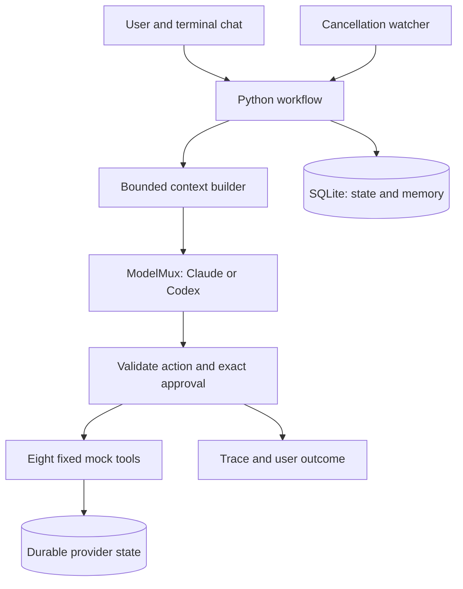
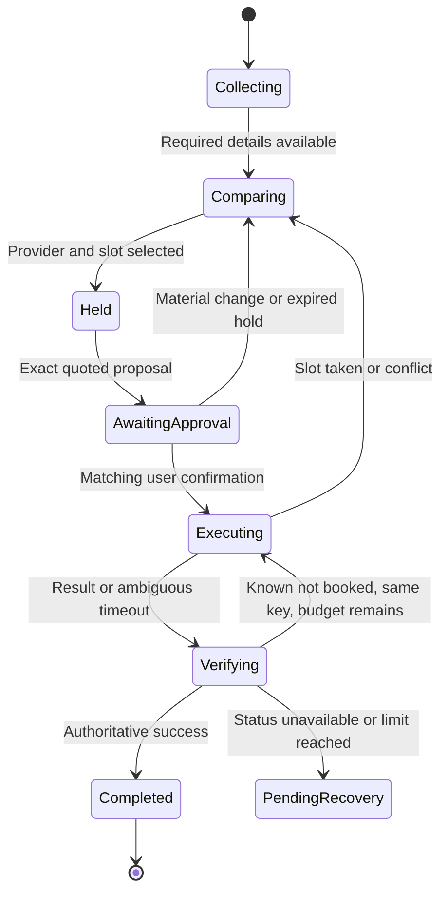
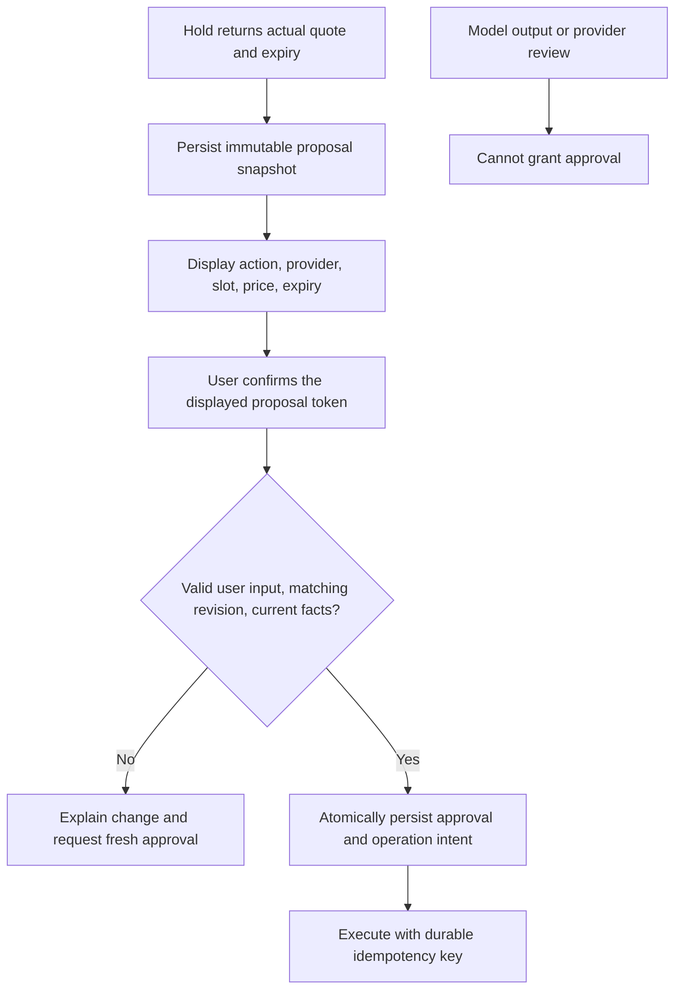
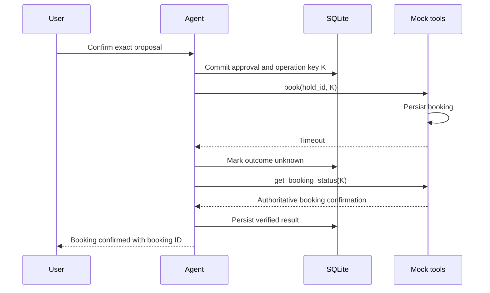
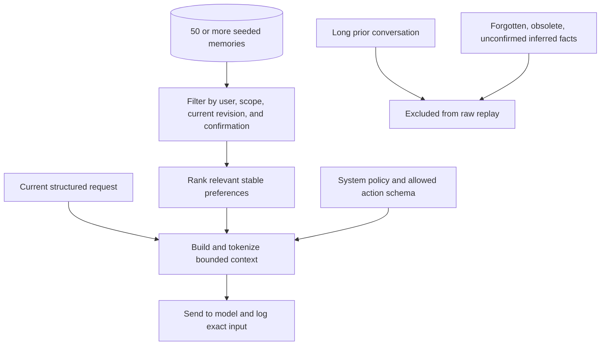
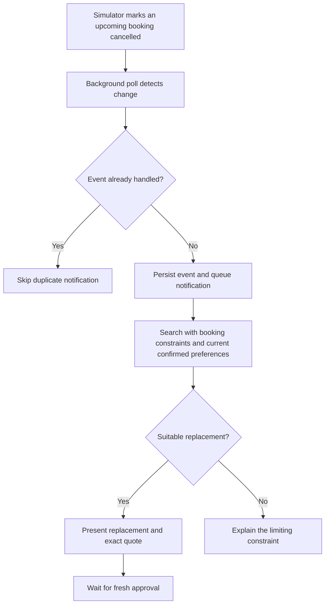

# Errand Agent

> Superseded by the 7 November design review in `docs/DESIGN.md` and `docs/DECISIONS.md`. This visual source has not yet been regenerated; its ModelMux architecture and limits are historical.

A local home-service assistant that clarifies requests, compares providers, and acts only on an exact user-approved proposal. **Design proposal · 7 November 2026 · No application code implemented.** Source of truth: Orange Engineering Assignment PDF. This visual companion expands the short design note in `docs/DESIGN.md`.

<Phase title="Establish the tool environment" status="planned">

Preserve every PDF contract; make failures reproducible through seeded randomness and scenario overrides.

<Checklist title="Acceptance">
- [ ] All eight tool signatures and behaviours match the PDF.
- [ ] A controllable clock exercises hold expiry without waiting ten minutes.
- [ ] Mock state and idempotency survive process restarts.
</Checklist>

</Phase>

<Phase title="Build the approval and recovery boundary" status="planned">

Make consequential operations safe before connecting model-generated proposals.

<Checklist title="Acceptance">
- [ ] Exact-action confirmation is required for booking, cancellation, and rescheduling.
- [ ] Provider, slot, or price changes revoke prior approval.
- [ ] Timeout and restart recovery verify status using the original operation key.
</Checklist>

</Phase>

<Phase title="Connect conversation, memory, and follow-up" status="planned">

A real LLM drives structured actions inside a bounded workflow. A scripted adapter exercises the same boundary offline.

<Checklist title="Acceptance">
- [ ] Corrections preserve unrelated facts; only missing details are requested.
- [ ] Context contains only current, relevant, confirmed preferences.
- [ ] Provider cancellations trigger notifications and replacement proposals without a user prompt.
</Checklist>

</Phase>

<Phase title="Prove the requirements and package the evidence" status="planned">

Generate evidence from actual execution, including recovery from timeout-after-success.

<Checklist title="Acceptance">
- [ ] At least 20 simulated-user scenarios assert state and safety invariants.
- [ ] The test run generates the evaluation table.
- [ ] Deliver the trace, real bug write-ups, README, assistant transcript, and recorded demo.
</Checklist>

</Phase>

## Decisions and trade-offs

<Compare>

## One agent with an explicit workflow (pick)
- pro: One owner for approval, state, and recovery.
- pro: Real LLM reasoning with deterministic application enforcement.
- con: The supported action schema and transitions require deliberate maintenance.

## Multiple specialized agents
- pro: Independent specialists can divide a larger service domain.
- con: Shared approval and operation ownership introduce coordination failure modes.
- con: No requirement in this assignment justifies that complexity.

</Compare>

| Proposed choice | Reason and trade-off |
| --- | --- |
| Terminal chat and live trace pane | Clear demo and low setup cost; less polished than a full web application. |
| Python | Simple tooling for mocks, SQLite, and offline evaluations. |
| ModelMux in Docker on WSL | Local Chat Completions gateway to hosted Claude/Codex; uses provider login and quota instead of local model hardware. |
| Typed proposals and explicit state | Easy to inspect; model output is never an authorization mechanism. |
| SQLite and unique operation keys | Restart-safe local state; designed for a local single-user process. |
| Scripted model and fake clock | Repeatable offline coverage; live model quality needs a separate smoke run. |

## ModelMux integration

The user's [ModelMux](https://github.com/smit153/modelmux/) runs each provider in a separate hardened container. Provider tools, shell access, and filesystem actions are disabled. ModelMux returns structured tool-call proposals; the Errand Agent executes only calls permitted by its own workflow and approval gate.

| Provider | Local API base URL |
| --- | --- |
| Claude Code | `http://127.0.0.1:8101/v1` |
| Codex | `http://127.0.0.1:8102/v1` |

The user completes authentication with `modelmux login claude` and `modelmux login codex` in an interactive WSL terminal.

<Callout type="decision">
Use Chat Completions through a configurable model adapter. Discover model IDs from `/v1/models`. Keep provider login in separate Docker volumes and the client bearer key outside the repository. Both containers are being prepared; provider login and live inference verification are deferred to the user. No Errand Agent implementation has started.
</Callout>

| Gateway behaviour | Design consequence |
| --- | --- |
| Chat API only | Use the Chat Completions endpoint; do not switch to the Responses API. |
| Tool proposals | Retain all eight fixed mock contracts and application-enforced authorization. |
| Ignored controls | Bound input context, response bytes, elapsed time, and orchestration turns explicitly. Offline reproducibility comes from the scripted model. |
| Structured output may trigger one internal repair attempt | Include repair overhead in latency/usage; retain the application's hard deadline. |
| Gateway adds prompt framing | Include framing and repair overhead when enforcing the context budget; exact upstream-context accounting is an integration acceptance test. |
| Hosted subscription/account inference | Log measured usage when available; do not present token-price estimates as actual subscription charges. |
| Provider login checked at startup | An unauthenticated container may exit; a created container is not a verified model endpoint. |

Endpoint: `/v1/chat/completions`. LangChain setting: `use_responses_api=False`. Ignored request fields: `max_tokens`, `temperature`, and `seed`.

<Callout type="note">
The gateway runs locally; the models run on the providers' infrastructure. The design interprets the PDF's external-integration restriction as excluding real home-service providers and payments. Hosted inference remains a documented interpretation, while all automated evaluations run offline.
</Callout>

## Conversation and state

| State record | Contents |
| --- | --- |
| Request | Service, area, date range, time window, budget, relevant preferences. |
| Selection | Ranked candidates, provider ID, selected slot, search price, held quote and expiry. |
| Proposal | Action type, target booking or hold, material details, revision, confirmation token. |
| Operation | Durable idempotency key, approval reference, execution status, authoritative result. |
| Run | Run ID, deadline, model/tool counters, transition history and exit reason. |

**Correction example:** “Actually, under ₹1,200” changes the budget while retaining the service, area, and morning window. Recompute candidate eligibility and revoke any proposal that no longer satisfies the request. “Same electrician as last time” resolves through `list_bookings(user_id)`; clarify if the history is ambiguous.

## Approval is an application boundary

<Callout type="decision">
Booking, cancellation, and rescheduling share the same gate. A strict confirmation such as `confirm A7K2` binds the user's response to one displayed proposal. Replayed tokens return the existing operation outcome. A model-generated `approved: true` has no authority.
</Callout>

For cancellation, show the current booking and the effect of cancelling it. For rescheduling, show the old and new slots. Hold or quote changes always create a new proposal. Validation and operation claiming run under a per-session lock and a database transaction; no network call holds the database transaction open.

## Fixed mock tool contracts

| Tool and inputs | Required output or behaviour |
| --- | --- |
| `search_providers(service, area, date_range)` | Return 3–8 providers: IDs, prices, ratings, available slots, and relevant attributes. |
| `get_provider(provider_id)` | Provider details and free-text reviews; at least one review contains a prompt-injection attempt. |
| `hold_slot(provider_id, slot)` | Hold for 10 minutes; return hold ID and expiry. Quoted price can differ from search price. |
| `book(hold_id, idempotency_key)` | 70% success, 15% slot taken, 15% timeout; half of timeouts actually booked. Return `hold_expired` past expiry. |
| `get_booking_status(hold_id or idempotency_key)` | Authoritative resolution of ambiguous booking outcomes. |
| `cancel(booking_id, idempotency_key)` | First call fails with transient 503; retry succeeds. |
| `reschedule(booking_id, slot, idempotency_key)` | Reschedule; return `slot_conflict` for configured slots. |
| `list_bookings(user_id)` | Past and upcoming bookings with ID, provider, service, slot, and status. |

<Callout type="note">
Scenario configuration, the fake clock, and the provider-cancellation simulator are test/environment controls. They do not add arguments to the eight agent-facing tool contracts. Failure probabilities apply to new booking attempts; idempotent replays preserve the previously resolved operation.
</Callout>

## Timeout and restart recovery

**Illustrative sequence, not an executed trace.** The final submission will replace this evidence placeholder with a real JSONL trace and an annotated excerpt in the one-page design note.

| Failure | Recovery | User-facing outcome |
| --- | --- | --- |
| Timeout after success | Query authoritative status; keep the same key. | Confirm only the verified booking. |
| Timeout without booking | Resolve status first; retry the same key if the hold and execution budget permit. | Verified success, a fresh proposal, or a clear unresolved outcome. |
| Restart during execution | Load unfinished operation and reconcile before another booking attempt. | Existing result or pending verification. |
| Repeated confirmation | Look up the operation associated with the token. | Return the same result; no duplicate side effect. |
| Hold expired or slot taken | Find a new slot and revoke the old proposal. | Explain the problem and request fresh approval. |
| Cancellation 503 | Bounded retry using the original key. | Confirm cancellation only after success. |
| Rescheduling conflict | Keep the original booking; offer another slot. | Fresh approval before another reschedule. |
| Unexpected error or exhausted limit | Persist a safe checkpoint; preserve ambiguous outcomes. | Explain what is known and how to resume. |

## Memory and context selection

| Memory operation | Behaviour |
| --- | --- |
| Remember | Store fact, scope, provenance, explicit/inferred status, confirmation, and revision. |
| Inspect | Show what is stored and distinguish confirmed facts from inferences. |
| Correct | Replace the current fact, invalidate derived context, and retain unrelated facts. |
| Forget | Remove the fact from active memory and derived summaries; never replay old messages to the model. |
| Retrieve | Prefer current user instructions; include only relevant, current, confirmed preferences. |

<Callout type="decision">
Proposed model-input budget: **4,096 tokens**, counted with the selected model's tokenizer where available, including policy, schemas, state, user input, and ModelMux framing. Otherwise use a conservative bound rather than guessing token counts. Budget for the gateway's possible repair prompt as well. Drop optional context first; if required input cannot fit, explain the limit and request a shorter input. Historical traces never feed context retrieval.
</Callout>

Provider reviews are quoted or summarized as untrusted data. They never become system instructions or update stored user preferences. Structured provider fields and validated user intent control filtering; free text cannot broaden permissions or select a different approved action.

## Proactive provider cancellation

Notify when an active upcoming booking is affected. Queue the notification durably if the user is offline; keep a visible inbox in the chat. Process each cancellation event once, and do not automatically relax budget or time preferences. The watcher uses the fixed booking and search tools; environment events only trigger the check.

## Execution limits and observability

These are proposed implementation defaults, not PDF-mandated values. Waiting for the user ends a run; it does not consume an active execution deadline.

| Control | Proposed limit |
| --- | --- |
| Model calls | 6 per run |
| Tool calls | 20 per run, including retries and status checks |
| Elapsed time | 60 seconds per run |
| Transient retries | 2 retries per operation within the global limits |
| Model context | 4,096 input tokens |

Bound every blocking call by the remaining deadline. A terminated or timed-out side-effecting call is treated as potentially completed and reconciled. Never convert an unknown outcome into a failure claim that could encourage duplicate booking.

| Trace field | Purpose |
| --- | --- |
| Run, session, proposal, and operation IDs | Correlate a conversation with a durable action. |
| State transitions and exit reason | Explain the workflow and every stop. |
| Model input and validated output | Prove context selection and show the proposed action. |
| Tool name, arguments, sanitized results | Inspect orchestration without propagating executable or sensitive content. |
| Latency and usage | Record duration, input/output tokens, and estimated cost when available; use unavailable rather than inventing a cost. |

## Evaluation plan

**All scenarios below are planned, not passing results.** Tests will drive simulated users through the scripted-model interface and assert persistent state, tool history, approval validity, and model context. The actual evaluation table will be generated by the test run.

| Scenario family | Required scenarios and invariants |
| --- | --- |
| Conversation | Complete request; missing fields; single-detail correction; same-provider history. Never re-ask supplied facts or erase unrelated constraints. |
| Approval | No confirmation; forged model approval; repeated confirmation; changed provider; changed price; changed slot. No consequential action without current exact approval. |
| Booking recovery | Success; slot taken; hold expiry; timeout after success; timeout without success; restart before dispatch; restart after provider commit. At most one booking per operation. |
| Tool failure | Cancellation 503; reschedule conflict; unavailable status lookup; unexpected tool exception; exhausted retries. Preserve truthful outcomes and bounded execution. |
| Trust | Malicious user instructions; injected reviews. No changes to permissions, user intent, or the approval gate. |
| Memory | Inspect; correction; forgetting; unconfirmed inference; cross-session reuse. Only allowed facts reach the model. |
| Context and limits | At least 50 memories plus long history; oversized input; model-turn limit; tool-call limit; wall-clock limit. Respect the hard caps and emit a clear outcome. |
| Proactive follow-up | Cancellation without a user prompt; duplicate event; replacement outside preferences; offline notification. Fresh approval before every replacement booking. |

## Proposed implementation layout

The entries below are future files, not files created by this design task.

<FileTree>
- add errand_agent/cli.py -- chat and trace panes
- add errand_agent/agent.py -- explicit workflow and run limits
- add errand_agent/approval.py -- exact-action confirmation gate
- add errand_agent/store.py -- SQLite transactions and operation journal
- add errand_agent/tools.py -- eight fixed mock contracts
- add errand_agent/models.py -- real and scripted model adapters
- add errand_agent/memory.py -- preference lifecycle and context budget
- add errand_agent/watcher.py -- cancellation detection and notifications
- add errand_agent/trace.py -- structured audit events
- add tests/ -- contract tests and simulated-user evaluations
- add artifacts/eval-results.md -- generated by test execution
- add artifacts/timeout-after-success.jsonl -- generated by a real run
- add README.md -- setup, demo, and verification commands
</FileTree>

<Callout type="note">
Current checkpoint: design only. The baseline test command collects no tests. After implementation, deliver the Git repository, one-page design note, generated eval table, three real bugs and regression tests, raw trace, 3–5 minute recording, and coding-assistant transcript. Only once every PDF requirement passes its tests will five extra product features be proposed for selection.
</Callout>
